# TenderPocket — Enterprise Tender Management & Workflow Automation System

TenderPocket is an enterprise-grade web application and automation platform engineered for government and commercial tender tracking, GeM (Government e-Marketplace) portal synchronization, multi-department approval pipelines, and automated bid document compilation.

---

## 🏗️ Monorepo & System Architecture

TenderPocket features a modular full-stack architecture with a Next.js 16 (React 19) frontend and a Java 21 Spring Boot 3 enterprise service:

```
tender-pocket/
├── frontend/                                # Next.js 16 (React 19, Tailwind CSS 4)
│   ├── src/app/                             # App Router pages and API routes
│   │   ├── page.tsx                         # Role-Aware Dashboard & Approvals Center Drawer
│   │   ├── tenders/[id]/page.tsx            # Full-screen Tender Workspace & 8-Stage Stepper
│   │   ├── components/                      # Modular UI Components
│   │   │   ├── ApprovalsDrawer.tsx          # Unified Cross-Role Approvals Center Drawer
│   │   │   ├── DashboardHeader.tsx          # Navigation, Role Switcher & Real-time Stats
│   │   │   └── ...                          # Tender tables, filters, and modal dialogs
│   │   └── api/                             # SQLite Handlers & Spring Boot Proxy Routes
│   │       ├── approvals/                   # Centralized Approvals & Review Pipeline
│   │       ├── tenders/[id]/                # Clearance, Brochure, TPC, MIS Price, Bid Docs, Payment
│   │       └── auth/                        # Role authentication & user management
│   ├── src/lib/                             # Shared Utilities & Business Logic
│   │   ├── db.ts                            # SQLite Schema, Migrations, Auto-Seeders
│   │   ├── auth.ts                          # JWT Token verification & Role extraction
│   │   └── approvalsSync.ts                 # Request Deduplication & Cross-DB Reconciler
│   ├── scripts/                             # Test automation & portal sync scripts
│   │   ├── test-complete-workflow-suite.js  # 20-Point Automated Verification Suite
│   │   ├── sync-gem.js                      # GeM Portal Scraper & Sync
│   │   └── sync-emails.js                   # IMAP Mail Notification Parser
│   └── package.json                         # Configured for default dev port 8085
├── backend/                                 # Java 21 / Spring Boot 3 Enterprise Service
│   ├── src/main/java/com/tenderpocket/
│   │   ├── controllers/                     # REST Controllers (ApprovalController, TenderController)
│   │   ├── models/                          # JPA Entities (Tender, TenderApproval, User)
│   │   ├── repositories/                    # Spring Data Repositories
│   │   ├── services/                        # Scrapers, AI Analyzers, Document Generators
│   │   └── config/                          # Security, JWT (HS256/HS512), CORS Configuration
│   ├── src/main/resources/
│   │   └── application.properties           # PostgreSQL / Port 8090 configuration
│   └── pom.xml                              # Maven build specifications
├── TASK_CHANGELOG.md                        # Exhaustive changelog of all architectural enhancements
├── LOCAL_CHANGES_REPORT.md                  # Git delta and file audit report
├── .env.example                             # Unified root environment template
└── README.md                                # Comprehensive system documentation
```

### Resilient Dual-Database Architecture

- **Local SQLite Database (`frontend/tenders.db`)**: Provides instant, zero-configuration local persistence out of the box with zero external dependencies. Ideal for offline work, local development, and branch testing.
- **PostgreSQL Database (`backend/`)**: Provides enterprise-grade clustering, row-level locking, and transactional integrity when running the Spring Boot backend.
- **Transparent Failover / Hybrid Proxying**: Frontend API routes automatically attempt to communicate with the Spring Boot service (`http://localhost:8090`). If the backend is offline, the frontend seamlessly executes operations against local SQLite without breaking the user experience.

---

## 🔄 GeM Tender Workflow: 7 Steps and the Parallel Brochure

TenderPocket moves every tender through a strictly gated, sequential, role-based pipeline of seven steps that guarantees specification compliance, commercial pricing confidentiality, document verification, and submission accountability. These are the same steps shown in each tender's **Workflow Pipeline Progress** stepper and on the **Status** dashboard cards. When the Clearance Team grants clearance, the **Brochure Team** is also asked for a product brochure. That upload runs **in parallel** and never blocks a step.

### End-to-End Workflow Diagram

```mermaid
flowchart TD
    START([Tender discovered on GeM]) --> S1

    subgraph STEP1 ["Step 1: Executive Assignment · MIS Team"]
        S1["MIS Team reviews the new tender"] --> S1_DEC{"Participate?"}
        S1_DEC -->|"Not Participating"| S1_NO(["Not Participating"])
        S1_DEC -->|"Assign & Participate"| S1_OK["Tender Executive assigned"]
    end

    subgraph STEP2 ["Step 2: Technical Specification · Tender Executive → Clearance Team"]
        S2_GEN["Executive uploads the tender document<br/>AI builds the specification sheet: PDF, Word, Excel"]
        S2_GEN --> S2_REQ["Executive sends the specification to a Clearance Team member"]
        S2_REQ --> S2_REV{"Clearance Team review"}
        S2_REV -->|"Grant Clearance: All Comply or Comply with Deviations"| S2_OK["Specification cleared<br/>Corrected files, if uploaded, replace the AI files"]
    end

    subgraph BROCHURE ["Parallel: Brochure Upload · Brochure Team (never blocks a step)"]
        BR_PEND["brochure_status = Pending"] --> BR_UP["Brochure Team uploads one brochure<br/>PDF, Word or Excel, up to 50 MB"]
        BR_UP --> BR_OK["brochure_status = Uploaded<br/>Listed in the Document Repository"]
    end

    subgraph STEP3 ["Step 3: Bid Document Preparation · Tender Executive"]
        S3_GEN["Executive generates the bid package: DOCX and PDF<br/>Does not wait for the brochure"]
    end

    subgraph STEP4 ["Step 4: EMD Payment · Tender Executive → MIS Team"]
        S4_CHK{"EMD applicable?"}
        S4_CHK -->|"Yes"| S4_PAY["Executive enters the EMD payment details"]
        S4_PAY --> S4_REV{"MIS Team sign-off"}
        S4_REV -->|"Changes requested"| S4_PAY
    end

    subgraph STEP5 ["Step 5: Pricing & Verification · Dual Track"]
        S5_FORK(("Both tracks<br/>run in parallel"))
        S5_FORK --> TA_ROUTE{"Track A: pricing route<br/>chosen by the Executive"}
        TA_ROUTE -->|"Option 1: TPC"| TA_TPC["TPC Pricing Team enters the purchase price<br/>🔒 masked from the Executive"]
        TA_ROUTE -->|"Option 2: direct to MIS"| TA_FIN["MIS Team sets the final price<br/>commercial go-ahead"]
        TA_TPC --> TA_FIN
        S5_FORK --> TB["Track B: MIS Team audits the bid folder documents"]
        TA_FIN --> S5_JOIN{"Both tracks approved?"}
        TB --> S5_JOIN
    end

    subgraph STEP6 ["Step 6: Final Submission · Tender Executive → MIS Team"]
        S6_SUB["Executive submits the bid on the GeM portal"]
        S6_SUB --> S6_AUD{"MIS Team filing audit"}
        S6_AUD -->|"Confirmed"| S6_OK["Officially submitted"]
    end

    subgraph STEP7 ["Step 7: Outcome · MIS Team"]
        S7_DEC{"Bid result"}
        S7_DEC -->|"Won"| S7_WON(["🏆 Won / Awarded"])
        S7_DEC -->|"Lost"| S7_LOST(["❌ Lost, reason recorded"])
    end

    %% Hand-offs between steps (kept outside the subgraphs so every node stays in its own step)
    S1_OK --> S2_GEN
    S2_OK --> S3_GEN
    S2_OK -.->|"in parallel"| BR_PEND
    S3_GEN --> S4_CHK
    S4_CHK -->|"Exempt or not applicable"| S5_FORK
    S4_REV -->|"Approved"| S5_FORK
    S5_JOIN -->|"Yes"| S6_SUB
    S6_OK --> S7_DEC

    classDef brochure fill:#ccfbf1,stroke:#0d9488,stroke-width:2px,color:#134e4a;
    classDef approved fill:#dcfce7,stroke:#16a34a,stroke-width:2px,color:#14532d;
    classDef rejected fill:#fee2e2,stroke:#dc2626,stroke-width:2px,color:#7f1d1d;
    class BR_PEND,BR_UP,BR_OK brochure;
    class S7_WON approved;
    class S1_NO,S7_LOST rejected;
```



---

### Detailed Step Breakdown

| Step | Name | Who acts | `current_stage` | Opens when | What happens |
| :--: | :--- | :--- | :--- | :--- | :--- |
| **1** | **Executive Assignment** | MIS Team | `NEW` | A new tender arrives from GeM | MIS assigns a Tender Executive and records the participation decision (**Assign & Participate** or **Not Participating**). |
| **2** | **Technical Specification** | Tender Executive → Clearance Team | `SPEC_CLEARANCE` | An executive is assigned | The executive uploads the tender document, the AI builds the specification sheet (PDF / Word / Excel), and the executive sends it to a Clearance Team member. Clearance checks the parameters, can upload corrected files, and grants clearance as **All Comply** or **Comply with Deviations**. The tender then returns to the executive, and the Brochure Team is asked for the brochure at the same time. |
| **3** | **Bid Document Preparation** | Tender Executive | `BID_DOCS_PREPARATION` | Clearance is granted | The executive generates the bid package (DOCX & PDF) from the standard template. It does not wait for the brochure; once uploaded, the brochure is linked on this step. Pricing is not needed yet. |
| **4** | **EMD Payment** | Tender Executive → MIS Team | `PAYMENT_APPROVAL` | The bid package is generated | The executive enters the EMD payment details and MIS approves them or requests changes. A tender with exempt / not-applicable EMD skips this step. |
| **5** | **Pricing & Verification (Dual Track)** | Tender Executive, TPC Pricing Team, MIS Team | `DUAL_TRACK`, `TPC_PRICING`, `MIS_PRICING`, `DOC_VERIFICATION` | EMD is approved or exempt | **Track A:** the executive routes pricing to the TPC Pricing Team (confidential purchase price, masked from the executive) or directly to MIS, and MIS sets the final price. **Track B:** MIS audits the bid folder documents. Both tracks must pass. |
| **6** | **Final Submission** | Tender Executive → MIS Team | `SUBMISSION_READY` → `SUBMISSION_PENDING` | Both tracks are approved | The executive submits the bid on the GeM portal and MIS audits and confirms the filing. |
| **7** | **Outcome** | MIS Team | `WIN_LOSS_PENDING` → `WON` / `LOST` | The filing is confirmed | MIS records the result: **Won / Awarded**, or **Lost** with the reason. |
| **Parallel** | **Brochure Upload** | **Brochure Team** | Not changed (`brochure_status`: `Pending` → `Uploaded`) | Clearance is granted | The Brochure Team uploads one brochure (PDF / Word / Excel, up to 50 MB). It is listed in the tender's **Document Repository**. It never blocks a step and never changes `current_stage`. |

### The Brochure Team (Parallel)

After the Clearance Team grants clearance (**All Comply** or **Comply with Deviations**), the tender
goes back to the Tender Executive for the bid package, and at the same time the **Brochure Team**
is asked for the brochure (`brochure_status = Pending`). Nothing waits for the brochure: a tender
can go through every step without one.

1. The Brochure Team logs in (`brochure`). Its dashboard shows **All Tenders**, **Pending Upload**
   and **Uploaded** cards, and its tender list contains only tenders with a brochure request.
2. It opens a tender and, in the **Brochure Upload (Parallel)** card, uploads one brochure
   document: PDF, Word (`.docx` / `.doc`) or Excel (`.xlsx` / `.xls`), up to 50 MB. PDF, `.docx`
   and `.xlsx` files are also checked by content, so a renamed file of another type is rejected.
3. The file is stored with the tender's other documents and listed in the tender's
   **Document Repository** as `Brochure - <file name>` (`brochure_status = Uploaded`). The
   tender stays at whatever step it has reached. The Tender Executive sees a link to the
   brochure in **3. Executive Handover & Document Preparation**.

Uploading again (**Replace Brochure**) replaces the file. Each tender's progress header shows a
**Brochure Pending** / **Brochure ✓** badge, and the Status page has a **Brochure (Parallel)**
card that counts active tenders still waiting for a brochure. Tenders cleared before the Brochure
Team existed have no `brochure_status` and do not appear in its list.

The `brochure` account is created on the first login after the backend starts with
`BROCHURE_DEFAULT_PASSWORD` set. Changing the variable later does not change an existing account's
password: Admin can reset it in **Team Profiles** by saving the `brochure` username again with the
**Brochure Team** role and the new password. More Brochure Team users can be created there too.

---

## 🔒 Role-Based Permissions & Confidentiality Matrix

TenderPocket enforces role-based access control (RBAC) at both the Next.js API layer and the Spring Boot controller layer.

| Feature / Action                                            |  Tender Executive  | Clearance Team |   Brochure Team    | TPC Pricing Team |  MIS Team  | Admin |
| :---------------------------------------------------------- | :----------------: | :------------: | :----------------: | :--------------: | :--------: | :---: |
| **Discover & View Tenders**                           |         ✅         |       ✅       | ✅ (brochure requests) |        ✅        |     ✅     |  ✅  |
| **Upload Technical Specs**                            |         ✅         |       ❌       |         ❌         |        ❌        |     ❌     |  ✅  |
| **Approve / Reject Tech Specs**                       |         ❌         |       ✅       |         ❌         |        ❌        |     ❌     |  ✅  |
| **Upload Brochure (PDF / Word / Excel)**              |         ❌         |       ❌       |         ✅         |        ❌        |     ❌     |  ❌  |
| **Input Manufacturer Quote (`tpc_purchase_price`)** |         ❌         |       ❌       |         ❌         |        ✅        |     ❌     |  ✅  |
| **View Manufacturer Quote (`tpc_purchase_price`)**  | 🚫**MASKED** |       ❌       |   🚫**MASKED**   |        ✅        |     ✅     |  ✅  |
| **Set Final Selling Price (`mis_final_price`)**     |         ❌         |       ❌       |         ❌         |        ❌        |     ✅     |  ✅  |
| **Generate Bid Documents (DOCX/PDF)**                 |     ✅ (Gated)     |       ❌       |         ❌         |        ❌        |     ❌     |  ✅  |
| **Verify & Approve Bid Documents**                    |         ❌         |       ❌       |         ❌         |        ❌        |     ✅     |  ✅  |
| **Process / Record EMD Payment**                      |         ❌         |       ❌       |         ❌         |        ❌        | ✅ (Gated) |  ✅  |
| **Record GeM Submission**                             |         ❌         |       ❌       |         ❌         |        ❌        |     ✅     |  ✅  |
| **Record Final Outcome (Won/Lost)**                   |         ❌         |       ❌       |         ❌         |        ❌        |     ✅     |  ✅  |
| **User Management & Audit Logs**                      |         ❌         |       ❌       |         ❌         |        ❌        |     ❌     |  ✅  |

### Commercial Confidentiality Guarantee

The matrix also applies to direct API calls and generic tender updates, not only
visible buttons. Legacy `MIS Executive` / `Executive` accounts are treated as
Tender Executives, `Specification Team` as Clearance Team, `TPC Team` as TPC
Pricing Team, and `Brochure` as Brochure Team. An invalid supplied JWT never falls back to role headers.
Authenticated teams may read a minimal username/role directory for assignments;
user-management operations, detailed account statistics, and audit logs are
Admin-only. Manufacturer pricing and cached pricing summaries are hidden from
the Executive, Clearance and Brochure roles, including nested API responses.

To protect sensitive vendor pricing, `tpc_purchase_price` is **strictly stripped and redacted** whenever an authenticated user with role `Tender Executive` requests tender data. Even if inspected via browser developer tools or network logs, the JSON response never contains the purchase price field for the Executive role.

---

## 🗂️ Approvals Center Architecture

The Approvals Center is a centralized workflow hub accessible via the **Approvals Drawer** or dedicated navigation tabs:

1. **Role-Specific Tab Views**:
   - `Clearance Team` sees pending Technical Specification reviews.
   - `TPC Pricing Team` sees tenders requiring OEM purchase quotes.
   - `MIS Team` sees pricing reviews, document verifications, EMD payments, and submission approvals.
   - `Admin` has a comprehensive view across all pending department stages.
   - `Brochure Team` has no Approvals Center queue: it uploads the brochure directly on the tender page, in parallel with the other steps, so no approval request is created.
2. **Request Deduplication & Uniqueness**:
   - Resubmitting a clearance or document request for a tender that already has an active pending request updates the existing record rather than creating duplicate queue items.
3. **Audit Trail & Feedback History**:
   - Every approval, rejection, or rework request requires a mandatory comment, permanently appended to the tender's audit timeline.

---

## 💻 System Prerequisites

| Requirement            | Recommended Version           | Minimum Version | Purpose                                                                        |
| :--------------------- | :---------------------------- | :-------------- | :----------------------------------------------------------------------------- |
| **Node.js**      | `v24.x`                     | `v22.12.0`    | Next.js frontend, document engine, test suites; Puppeteer requires Node 22.12+ |
| **npm**          | `v10.x`                     | `v9.x`        | Node package manager                                                           |
| **Java JDK**     | `Java 21` (Eclipse Temurin) | `Java 17`     | Optional: Spring Boot enterprise backend                                       |
| **Apache Maven** | `v3.9.x`                    | `v3.8.x`      | Optional: Building Java backend                                                |
| **PostgreSQL**   | `v16.x`                     | `v14.x`       | Optional: Enterprise database clustering                                       |

---

## ⚙️ Environment Configuration

For Docker, copy `.env.example` to `.env` in the repository root and replace every placeholder. `docker-compose.yml` contains no passwords, secrets or keys: it reads them all from `.env`, and it stops with an error if `JWT_SECRET`, `DATABASE_PASSWORD` or `BACKEND_URL` is missing. `.env` must never be committed.

### 1. Frontend Configuration (`frontend/.env.local`)

Copy the frontend environment template:

```bash
# Windows PowerShell
Copy-Item frontend/.env.example frontend/.env.local

# Linux / macOS
cp frontend/.env.example frontend/.env.local
```

Key environment variables:

```dotenv
PORT=8085
NEXT_PUBLIC_APP_URL=http://localhost:8085
BACKEND_URL=http://localhost:8090
JWT_SECRET=<same-long-random-secret-as-the-backend>
DATABASE_PATH=./tenders.db
```

### 2. Backend Configuration (`backend/.env` or `application.properties`)

```dotenv
PORT=8090
SPRING_PORT=8090
DATABASE_URL=jdbc:postgresql://localhost:5432/tenderpocket
DATABASE_USERNAME=postgres
DATABASE_PASSWORD=<your-postgres-password>
JWT_SECRET=<same-long-random-secret-as-the-backend>
```

---

## 🚀 How to Run the Application

### Option A: Running the Frontend (Port 8085 — Standalone Mode)

The frontend runs standalone with zero external dependencies using its built-in SQLite database:

```bash
cd frontend
npm install
npm run dev
```

Open your browser at: 👉 **[http://localhost:8085](http://localhost:8085)**

#### Customizing the Port:

- **npm**: `npm run dev -- -p 8086`
- **PowerShell**: `$env:PORT="8086"; npm run dev`
- **Bash**: `PORT=8086 npm run dev`

---

### Option B: Running the Spring Boot Backend (Port 8090)

```bash
cd backend
mvn spring-boot:run
```

Or run the production JAR:

```bash
mvn clean package -DskipTests
java -jar target/tender-pocket-spring-0.0.1-SNAPSHOT.jar
```

The Spring Boot backend will bind to: 👉 **[http://localhost:8090](http://localhost:8090)**

---

## 👥 Default User Accounts

The backend creates these accounts on the first login, using the passwords set in `.env`. Never commit real passwords:

| Username                | Role                       | Password (set in `.env`) | Dashboard & Functional Responsibility                                     |
| :---------------------- | :------------------------- | :--------------- | :------------------------------------------------------------------------ |
| **`admin`**     | **Admin**            | `ADMIN_DEFAULT_PASSWORD` | Full system oversight, audit logs, user management, overrides.            |
| **`executive`** | **Tender Executive** | `EXECUTIVE_DEFAULT_PASSWORD` | Specification uploads, bid document prep (DOCX/PDF).                      |
| **`clearance`** | **Clearance Team**   | `CLEARANCE_DEFAULT_PASSWORD` | Technical specification reviews, approvals, and rework feedback.          |
| **`brochure`**  | **Brochure Team**    | `BROCHURE_DEFAULT_PASSWORD` | Uploads the brochure (PDF / Word / Excel) for tenders the Clearance Team approved. |
| **`tpc`**       | **TPC Pricing Team** | `TPC_DEFAULT_PASSWORD` | OEM quotes, manufacturer pricing (confidential).                          |
| **`misteam`**   | **MIS Team**         | `MISTEAM_DEFAULT_PASSWORD` | Final pricing, doc verification, EMD payments, GeM submissions, outcomes. |

---

## 🧪 Comprehensive Automated Test Suite

TenderPocket includes a 20-point automated end-to-end verification suite covering the entire 8-stage lifecycle, rejection handling, request uniqueness, and role confidentiality boundaries.

### Running the Test Suite

Make sure the frontend is running on `http://localhost:8085`, then run:

```bash
node frontend/scripts/test-complete-workflow-suite.js
```

### Verified Test Cases

```
======================================================================
     TENDERPOCKET COMPREHENSIVE 20-POINT WORKFLOW TEST SUITE
======================================================================

[SECTION 1: HAPPY PATH (8 SEQUENTIAL STAGES)]
  [TEST 1] Create Fresh Tender & Upload Spec (CLEARANCE_PENDING) -> PASSED
  [TEST 2] Clearance Team Reviews & Approves Spec -> PASSED
  [TEST 3] TPC Team Enters Purchase Price Quote -> PASSED
  [TEST 4] MIS Team Enters Final Selling Price -> PASSED
  [TEST 5] Gating Check: Premature Generation Blocked -> PASSED
  [TEST 6] Executive Generates Bid Documents Pack (DOCX & PDF) -> PASSED
  [TEST 7] MIS Team Verifies & Approves Generated Bid Documents -> PASSED
  [TEST 8] MIS Team Verifies EMD Payment -> PASSED
  [TEST 9] MIS Team Confirms Final Portal Submission -> PASSED
  [TEST 10] Record Winning Tender Outcome -> PASSED

[SECTION 2: REJECTION & FEEDBACK LOOPS]
  [TEST 11] Spec Clearance Rejection & Rework Feedback Loop -> PASSED
  [TEST 12] Document Verification Rejection & Revision Notes -> PASSED
  [TEST 13] Payment Verification Rejection & Resubmission -> PASSED
  [TEST 14] Submission Verification Rejection & Correction -> PASSED
  [TEST 15] Bid Outcome: Lost with Reason & Competitor Data -> PASSED

[SECTION 3: UNIQUENESS & DEDUPLICATION]
  [TEST 16] Duplicate Clearance Submissions Update Existing Request -> PASSED
  [TEST 17] Resubmission After Rejection Updates Existing Request -> PASSED

[SECTION 4: CROSS-ROLE SECURITY & CONFIDENTIALITY]
  [TEST 18] Confidential Price Masking: Executive Cannot See TPC Purchase Price -> PASSED
  [TEST 19] Role Boundary: Executive Cannot Review Approvals (403 Forbidden) -> PASSED
  [TEST 20] Team Role Authorization: Clearance reviews Spec, TPC reviews Pricing -> PASSED

======================================================================
TOTAL TESTS: 20 | PASSED: 20 | FAILED: 0
SUCCESS RATE: 100.0%
N======================================================================
```

---

## 🐳 Docker Deployment

Multi-stage container definitions are included for containerized deployment:

```bash
# Frontend container (Port 8085)
cd frontend
docker compose up -d --build

# Backend container (Port 8090)
cd backend
docker compose up -d --build
```

---

## 🔍 Troubleshooting & FAQs

### 1. `EADDRINUSE: address already in use`

- Port `8085` or `8090` is already bound.
- Inspect bound ports: `netstat -ano | findstr 8085` (Windows) or `lsof -i :8085` (Mac/Linux).
- Update `PORT=8086` in `frontend/.env.local` or `SPRING_PORT=8092` in `backend/application.properties`.

### 2. Can the frontend run without PostgreSQL or Spring Boot?

- **Yes**: The frontend runs completely standalone via `frontend/tenders.db` (SQLite). All approval queues, document generation, and role workflows function seamlessly.

### 3. Missing or corrupted SQLite database

- Simply start the application (`npm rboot`
- `um run dev`
- `n dev`) or seed sample tenders (`node frontend/scripts/seed-workflow-tenders.js`). The schema auto-migrates and seeds users automatically.

---

## 📄 Documentation Links

- Detailed Engineering Changelog: [TASK_CHANGELOG.md](TASK_CHANGELOG.md)
- Local Code Changes Audit: [LOCAL_CHANGES_REPORT.md](LOCAL_CHANGES_REPORT.md)
- Workflow & Architecture Specification: [WORKFLOW_SYSTEM_ARCHITECTURE_REVIEW.md](WORKFLOW_SYSTEM_ARCHITECTURE_REVIEW.md)
